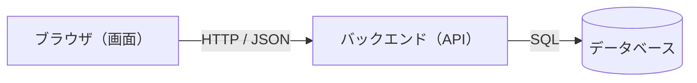
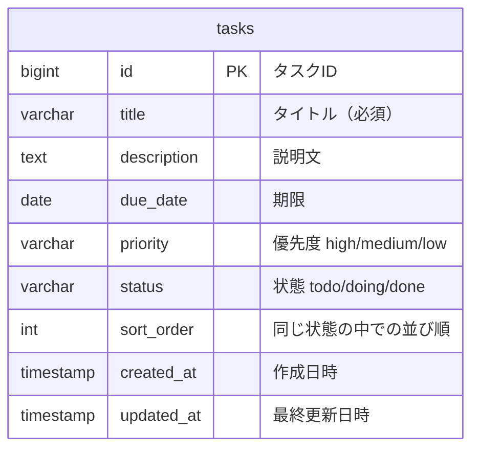

# データ設計書 — TaskManagement

← [要件定義書](./requirements.md) に戻る

関連文書：[機能要件・ユースケース](./functional-requirements.md) ／ [画面設計書](./screen-design.md) ／ [技術スタック](./tech-stack.md)

| 項目 | 内容 |
|---|---|
| 最終更新日 | 2026-11-17 |
| 版 | 3.5 |

---

## 1. システム構成

画面はデータベースを直接触らない。必ずバックエンドの API を経由する。

## 2. ER図

**エンティティは `tasks` の1つのみで、リレーションは存在しない。**

利用者が1名で認証を持たないため、`users` テーブルが不要だからである。図を充実させる目的でエンティティを増やすことはしない。

[要件定義書 8章「今後の拡張候補」](./requirements.md#8-今後の拡張候補) の「ユーザー登録・ログイン」を実装する段階で `users` が追加され、`users` 1 対 `tasks` 多 のリレーションが発生する。

## 3. テーブル定義：tasks

| カラム名 | 型 | NULL | 既定値 | 説明 |
|---|---|---|---|---|
| id | bigint | 不可 | 自動採番 | 主キー |
| title | varchar(100) | 不可 | ― | タイトル。空文字は許可しない |
| description | text | 可 | NULL | 説明文 |
| due_date | date | 可 | NULL | 期限 |
| priority | varchar(10) | 可 | NULL | `high` / `medium` / `low` |
| status | varchar(10) | 不可 | `todo` | `todo` / `doing` / `done` |
| sort_order | int | 不可 | ― | 同じ status の中での並び順 |
| created_at | timestamp(6) | 不可 | 現在時刻 | 作成日時 |
| updated_at | timestamp(6) | 不可 | 現在時刻 | 最終更新日時 |

`status` と `sort_order` の組み合わせで、ボード上のカードの位置が決まる。

**版3.1での修正（2026-09-06）**：版3.0では作成日時・最終更新日時の型を `datetime` と書いていたが、**PostgreSQL に `datetime` という型は存在しない**。実際に生成されたのは `timestamp(6) without time zone` だった。この表は上記の実物（`\d tasks` の出力）と一致している。

**既定値の与え方**：`status` の `todo`、作成日時・最終更新日時の現在時刻は、**DB の DEFAULT 制約ではなくアプリ側（エンティティ）で与えている**。値を入れる経路がバックエンドの API ひとつに限られるため、DB 側に二重で持たせても働く場面がない。`psql` から直接 INSERT する場合はこれらの既定値が効かないので、明示的に値を渡す必要がある。

## 4. status の値と表示名

| status の値 | 画面上の表示名 |
|---|---|
| `todo` | 未着手 |
| `doing` | 作業中 |
| `done` | 完了 |

カラムはアプリ側で固定とし、利用者による追加・変更・削除は行わない。

## 5. サンプルデータ

`backend/src/main/resources/data.sql` に6件（`todo` 3 / `doing` 2 / `done` 1）。**使い方の見本**で、タイトルの先頭に `【サンプル】` と付けてある（「【サンプル】カードをクリックすると編集できます」など）。

**入るのは `tasks` が0件のときだけ。** `spring.sql.init.mode=always` を設定してあるためスクリプト自体は**アプリケーションの起動のたびに実行される**が、`INSERT` の末尾に `WHERE NOT EXISTS (SELECT 1 FROM tasks)` を付けてあり、1件でも入っていれば何も起きない。

入ったあとは、画面から登録したタスクと同じ扱いになる。編集も削除もでき、起動し直しても元の内容には戻らない。

### 起動のたびに全件を消していた件（第15回の品質チェックで修正）

版3.4 までは、スクリプトの先頭に `DELETE FROM tasks` を置き、**既存の行を全部消してから6件を入れ直していた**。同じ行が起動のたびに増えるのを防ぐためだった（第10回に、6件が12件になるのを実際に踏んでいる）。

しかしこの形だと、**バックエンドを起動し直すたびに、画面から登録したタスクまで全部消える。** [完了条件](./requirements.md#7-完了条件受け入れ条件) #12「バックエンドを再起動してから開く → タスクがすべて残っている」と、[F-07](./functional-requirements.md#f-07-データの保存)（データの保存）を満たしていなかった。

登録 API ができた第12回の時点で実害になっていたが、「起動すると6件に戻る」ことを注意書きとして各所に書くだけで、**要件に反していることには気づいていなかった。** 重複を防ぐという目的は正しく、手段が強すぎた。

| 案 | 採否 | 理由 |
|---|---|---|
| **0件のときだけ入れる** | **採用** | 登録したタスクが残る。初めて起動した人には使い方が伝わる |
| ふだんは入れず、指定したときだけ入れる | 不採用 | 初めて起動した人に空のボードが出て、何ができるアプリかが伝わらない |
| 完了条件 #12 の方を書き換える | 不採用 | データが残らないタスク管理は、要件の方が正しい |

**残る性質：自分で全部消してから起動し直すと、0件なのでサンプルがもう一度入る。** 「一度でも入れたら二度と入れない」にするには入れた記録を別に持つ必要があり、そこまではしていない。

期限は固定の日付ではなく `CURRENT_DATE + 7` のように**起動した日から数えた日付**で入れる。固定の日付を書くと、日が経つにつれて全部が期限切れの見本になるため。

### id を書かない理由

`data.sql` の INSERT では `id` を指定していない。指定すると自動採番のシーケンス（次に配る番号の記録）とずれ、あとから API 経由で登録したときに主キーの衝突が起きるため。

**シーケンスは行を削除しても戻らない。** 第09回に `psql` から手で1行入れて削除したあと、テーブルは0件だったが次に配られた番号は `2` だった。「テーブルが空である」ことと「次の番号が1である」ことは別の状態である。

### テストはデータを変えない

テストは本番と同じ `task_management` データベースに接続する（[技術スタック](./tech-stack.md) 6章）。それでも登録済みのタスクには触れない。仕組みは2つある。

- **テストのときは `data.sql` を実行しない。** `src/test/resources/application-test.properties` の `spring.sql.init.mode=never`（第12回。[API設計書](./api-design.md) 7章）
- **テストが書いた行は毎回取り消す。** `TaskApiTests` に `@Transactional` を付けてあり、各テストの終わりに書き込みがすべて取り消される（第15回）

**取り消されないのは `id` の採番だけ**で、テストを実行するたびに次の番号が進む。上の「シーケンスは行を削除しても戻らない」と同じ性質である。

この節には版3.4 まで「`gradlew test` を実行すると中身が入れ替わる。対処が必要」と書いてあった。**第12回に対処したあとも、この文書だけ直していなかった。**

### 既定値が効かない点

`created_at` / `updated_at` / `status` は、`data.sql` の中で明示的に値を入れている。3章に書いたとおり、これらの既定値は DB の DEFAULT 制約ではなくエンティティ側（`Task.java`）で与えているため、SQL から直接 INSERT すると効かないためである。

### 実行順序の設定

`spring.jpa.defer-datasource-initialization=true` を設定してある。`data.sql` の実行を、Hibernate がテーブルを作り終えた後まで**遅らせる**設定である。名前に「初期化」とあるがデータを消す設定ではない。

`false`（既定）のままだと、空のデータベースから起動したときにテーブルが存在しない状態で `data.sql` が走り、起動に失敗する。

## 6. 読み仮名の列を持たない理由

[F-09 のソート](./functional-requirements.md#f-09-カードの並び替えソート)の軸から**「タイトルのあいうえお順」を外している**。この表に読み仮名の列がないためで、**列を足さない限り実装できない**。

**データベースは漢字の読みを持たない。** 日本語7語を実際に並べて確認した。

| 指定 | 結果 |
|---|---|
| `ORDER BY title`（既定） | あさひ / アサヒ / 大阪 / 山田 / 朝日 / 東京 / 田中 |
| `ORDER BY title COLLATE "ja-x-icu"`（日本語ロケール） | あさひ / アサヒ / 山田 / 大阪 / 朝日 / 田中 / 東京 |

既定は文字コード順で、**ひらがな・カタカナは正しく並ぶが漢字が総崩れ**になる。日本語ロケールを指定すると順序は変わるが五十音順にはならず、**漢字は部首・画数の順**に並ぶ。「東京（とうきょう）」が「田中（たなか）」より後に来ているのがその証拠である。

五十音順にするには `title_kana` のような読み仮名の列を追加し、タスクを作るたびに読みを入力する必要がある。**入力を1項目増やす負担に見合わないと判断し、軸そのものを落とした。**

（ブラウザ側で日本語入力の変換前の文字列を拾って自動で埋める方法もあるが、**コピー＆ペーストしたタイトルは変換を経ていないため拾えない**。自動入力だけでは列は埋まりきらない。）

## 7. 削除した行を残さない理由

[F-04 カードの削除](./functional-requirements.md#f-04-カードの削除)は**物理削除**——行そのものを消す形で実装している。**消したものは元に戻せない。**

削除の作り方は2つある。

| | やること | 元に戻せるか |
|---|---|---|
| **物理削除（採用）** | 行を消す | 戻せない |
| 論理削除 | 「消えたことにする」印を列に持ち、印の付いた行は表示しない | 戻せる |

### 「削除」という一語が指しているものを分ける

「不要なタスクを削除できる」という一文は、**そのままでは何を作る機能なのか決まっていない。** 消したい理由が違えば、作るものが変わるためである。

| 消したい理由 | 本当に必要な機能 |
|---|---|
| 間違えて作った | **削除**（行を消す） |
| もう見る必要がない | **削除**（行を消す） |
| 終わったので片付けたい | **削除ではない。** `status` を `done` にする＝更新 |
| あとで見返すかもしれない | 削除ではない。非表示＝論理削除 |

**このアプリに当てはまるのは上の2つだけである。**

3つ目が削除でないことは、このアプリでは特にはっきりしている。**ボードなので、完了したカードは見えていてほしい。** どれだけ終わったかが一目で分かることがボードの値打ちで、完了したものを隠す機能はここには要らない。`status` に `done` があり、完了は最初から**更新**として扱われている。

4つ目も外れる。カード1枚が持っているのはタイトル・説明・期限・優先度の4つだけで、**消して困ったら作り直す方が速い。** 戻す仕組みを用意する値打ちがない。

### 論理削除にすると必ず増える3つ

「一応戻せるようにしておく」を選ぶと、次の3つが付いてくる。

1. **`deleted_at`（削除日時）の列** — この表に1列足す
2. **読み取り API すべてに絞り込み** — 全件・1件・`status` 絞り込みの3本すべてに「まだ消えていないもの」の条件が要る。**1か所でも書き忘れると、消したはずのカードが画面に出る**
3. **「どうやって戻すか」の画面と操作** — 戻せる形にしても、戻す手段が無ければ意味がない。一覧に出さないものを、どこから見て、どう戻すのかを新たに決めることになる

戻したい場面が実在しない以上、この3つを払う理由がない。**だから物理削除を採った。**

### 「削除フラグ」という言い方をしない

論理削除の印には `is_deleted` のような真偽値（削除フラグ）がよく使われるが、この名前は**作る側の都合**でできている。利用者は「フラグを立てたい」とは思っていない。

印を持つなら**日時**（`deleted_at`）の方が良い。オンかオフかしか分からない真偽値と違って、**いつ消したのかが残る**ためである。値が入っていること自体が「消した」を意味するので、真偽値と同じ働きもする。

そして、印を持つと決める前に確かめることがある。**「終わったら隠したい」なら、それは削除ではなく `status` の更新である。** 削除という言葉のまま設計に持ち込むと、**更新で済むものに列が1つ増える。**

### 削除しても並び順の番号は詰めない

物理削除で行が消えると、`sort_order` に穴が空く。実測（第14回）では、`todo` の3枚（1・2・3）の真ん中を消したところ **1・3 が残った**。

**詰め直していない。** 画面は `sort_order` の昇順に並べるだけなので、番号が飛んでいても**表示される順番は変わらない**。詰めるとなると列の中の複数件を一度に書き換える操作になり、[F-06（同じ列の中での並び替え）](./functional-requirements.md#f-06-同じ列の中での並び替え)と同じ形になる（[API設計書](./api-design.md) 6章）。

---

## 改訂履歴

| 版 | 日付 | 内容 |
|---|---|---|
| 3.1 | 2026-09-06 | 作成日時・最終更新日時の型を `datetime` から `timestamp(6)` に修正（PostgreSQL に `datetime` 型は存在しない）。既定値をアプリ側で与えている点を明記 |
| 3.2 | 2026-09-07 | **テストデータの節（5章）を新規追加。** `data.sql` の投入方法、`id` を書かない理由、シーケンスが削除で戻らないこと、`defer-datasource-initialization` の意味を記載 |
| 3.3 | 2026-09-10 | **6章「読み仮名の列を持たない理由」を新規追加。** F-09 のソートの軸から「タイトルのあいうえお順」を外した根拠として、`COLLATE` を変えても漢字が五十音順に並ばないことの実測結果を記載 |
| 3.4 | 2026-09-12 | **7章「削除した行を残さない理由」を新規追加。** F-04 を物理削除で実装するにあたり、「削除」という一語が指すものを4つに分けて、このアプリに当てはまるのは2つだけであることを整理。論理削除を採らなかった理由（必ず増える3つ）と、「削除フラグ」ではなく削除日時を持つべき理由を記載。削除で `sort_order` に穴が空くが詰めない判断も記載 |
| 3.5 | 2026-11-17 | **5章を「テストデータ」から「サンプルデータ」に改めた。** 起動のたびに全件を消して入れ直していたため、登録したタスクが再起動で消え、完了条件 #12 を満たしていなかった（第15回の品質チェックで発見）。0件のときだけ入れる形に変更し、検討した3案を記載。あわせて、第12回に解決済みだった「テストがデータを入れ替える」の記述が残っていたのを現状に直した |
